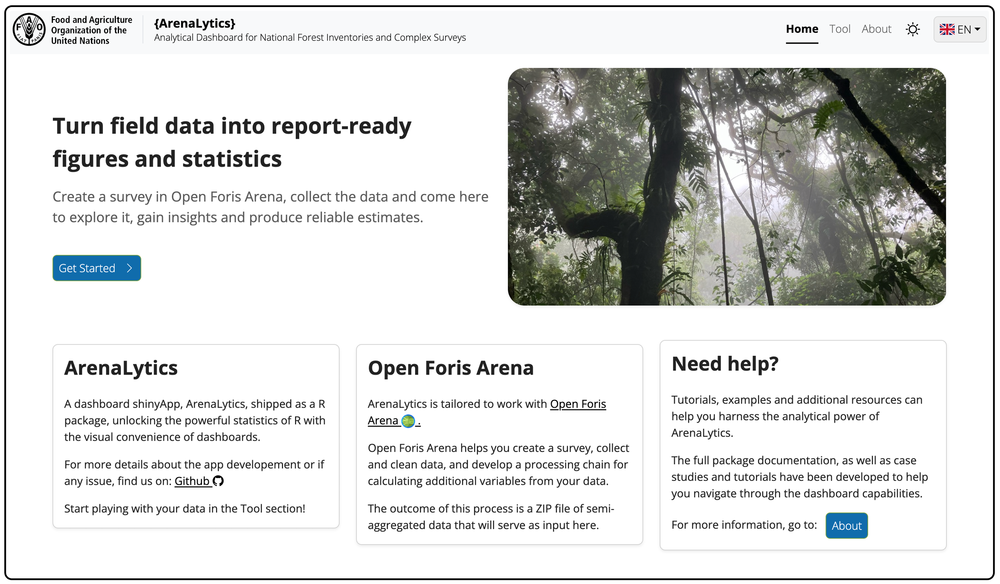
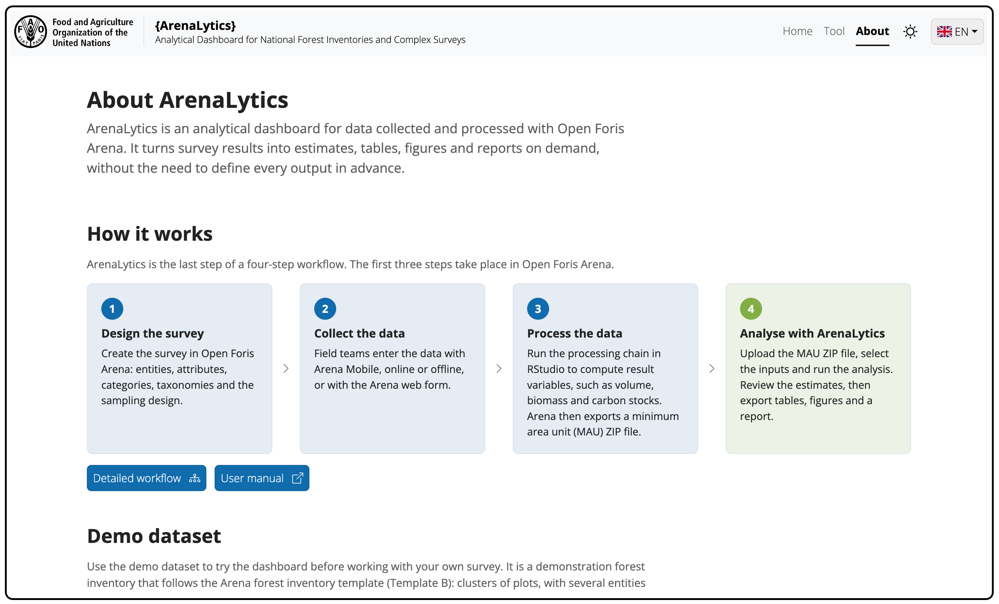

<!-- badges: start -->
[](https://github.com/openforis/arenalytics/actions/workflows/R-CMD-check.yaml)
<!-- badges: end -->

# ArenaLytics

**ArenaLytics is an analytical dashboard for data collected and processed with [Open Foris Arena](https://www.openforis.org/arena/).**
It turns survey results into estimates, tables, figures and reports on demand, without the need to define every output in advance.

[Install and run](#install-and-run) · [Documentation](https://openforis.github.io/arenalytics/) · [User guide](https://openforis.github.io/arenalytics/articles/user-guide.html) · [Latest developments](https://openforis.github.io/arenalytics/articles/latest-developments.html)




## How it works

ArenaLytics is the last step of a four-step workflow. The first three steps take place in Open Foris Arena.

1. **Design the survey** in Open Foris Arena: entities, attributes, categories, taxonomies and the sampling design.
2. **Collect the data** with Arena Mobile, online or offline, or with the Arena web form.
3. **Process the data**: run the processing chain in RStudio to compute result variables, such as volume, biomass and carbon stocks. Arena then exports a minimum area unit (MAU) ZIP file.
4. **Analyse with ArenaLytics**: upload the MAU ZIP file, select the inputs and run the analysis. Review the estimates, then export tables, figures and a report.



## Install and run

### Local installation (recommended)

Install and run ArenaLytics in R on your machine:

1. Install R and RStudio. If they are new to you, follow [Installing R and RStudio](https://rstudio-education.github.io/hopr/starting.html) in *Hands-On Programming with R*.
2. Start R or RStudio and run this code in the Console to install the package and launch the app:

   ```r
   if (!require(remotes)) install.packages("remotes")
   remotes::install_github("openforis/arenalytics", upgrade = "never")
   arenalytics::shiny_run_arenalytics()
   ```

To try the dashboard without installing it, use the [online version](https://openforis-shiny.shinyapps.io/arenalytics/).

## Dashboard pages

- **Home**: introduction to the dashboard, with links to the Tool and About pages.
- **Tool**: upload the data, set up the analysis and explore the results.
  - Step 1, Load ZIP file: upload and check the MAU ZIP file, then read the data.
  - Step 2, Select inputs: analysis type, entity, and base-unit and sub-unit dimensions.
  - Step 3, Configure analysis: handling of lonely primary sampling units, computation mode and confidence level.
  - Insights panel: survey summary, sampling design, entities, dimensions and measures.
  - Analysis panel: means per hectare and totals with confidence intervals, as figures and tables, with exports to PNG, CSV and a Word or HTML report.
- **About**: workflow, demo dataset, context and technical information on the package.

A demo dataset is available on the About page to try the analysis before working with your own survey.

## Latest developments

**In the pipeline**

- Handling of additional complex surveys, panelization and ratio estimators.
- Use-case demonstrations.

**October 2026**

- New analysis setup: separate steps to select the inputs and configure the analysis, with switches and dimension chips.
- Category dimensions keep the order defined in the survey in tables, figures and filters.
- Updated package dependencies for online deployment.

See the [full changelog](https://openforis.github.io/arenalytics/articles/latest-developments.html).

## Misc

### Prepare multiple offline installations

To prepare for multiple installations in computers without internet access, see [Installing ArenaLytics offline](https://openforis.github.io/arenalytics/articles/offline-install.html).

### Development version

The development version is at [gaelso/arenalytics_dev](https://github.com/gaelso/arenalytics_dev):

```r
remotes::install_github("gaelso/arenalytics_dev", ref = "dev")
arenalytics::shiny_run_arenalytics()
```

*Installing the development version is not recommended: it may contain bugs in the application or errors in the survey estimates.*

### Licence

MIT, © 2026 FAO. See [LICENSE](LICENSE). The FAO logo and the FAO Global Goals visual identity are not covered by this licence.
