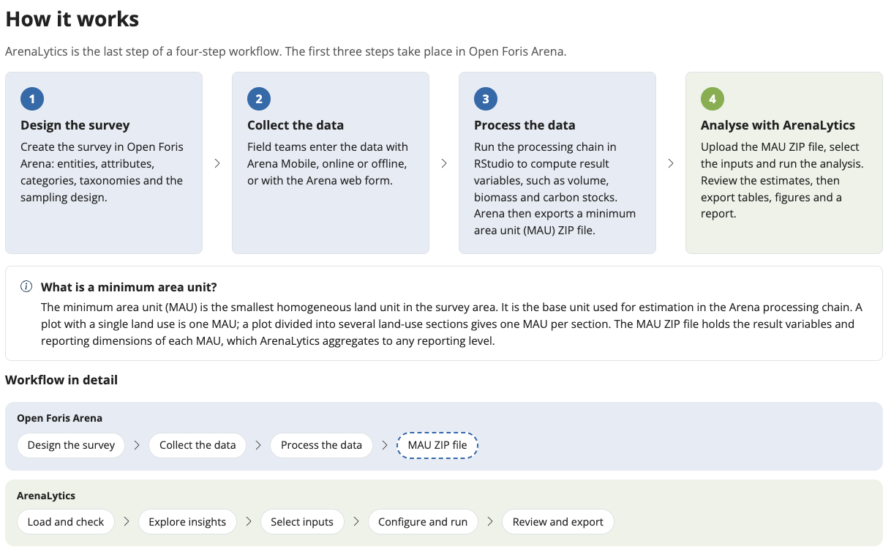

```{r setup, include = FALSE}
knitr::opts_chunk$set(echo = TRUE, eval = FALSE)
```

This guide summarizes the ArenaLytics section of the
[Open Foris Arena user manual](https://docs.google.com/document/d/1GWerrExvbdT5oOOlwdkE9pptK4pVbQxwtgaSNPasmKA/view?tab=t.0#heading=h.5t6dmkawvkp9).
Refer to the manual for full details.

## What ArenaLytics does

ArenaLytics is an analytical dashboard for data collected and processed with
Open Foris Arena. It was developed for national forest inventories and other
sample-based surveys, where users need estimates such as biomass, tree density,
volume or carbon stocks across many reporting domains.

Users select the measures, dimensions and filters they need, and the dashboard
computes means, totals and their sampling errors on demand. There is no need to
define every output in advance.

## Workflow

ArenaLytics is the last step of a four-step workflow:

1. Design the survey in Open Foris Arena: entities, attributes, categories,
   taxonomies and the sampling design.
2. Collect the data with Arena Mobile, online or offline, or with the Arena web
   form.
3. Process the data: run the processing chain in RStudio to compute result
   variables. Arena then exports a minimum area unit (MAU) ZIP file.
4. Analyse the MAU ZIP file with ArenaLytics: load and check the file, explore
   the survey, select the inputs, configure and run the analysis, then review
   and export the results.



## The minimum area unit ZIP file

The minimum area unit (MAU) is the smallest homogeneous land unit in the survey
area. It is the base unit used for estimation in the Arena processing chain:

- a plot with a single land use or vegetation type is one MAU; and
- a plot divided into several land-use or vegetation sections gives one MAU per
  section.

An Arena system script generates the MAU ZIP file automatically. It contains:

- the result variables of each MAU;
- the reporting dimensions derived from categorical, taxonomic and Boolean
  attributes; and
- the pre-computed measures that ArenaLytics aggregates into means, totals,
  tables, figures and sampling errors for any combination of dimensions.

In a typical forest inventory, each record of the MAU file is one homogeneous
plot section, with its area-based variables and reporting dimensions.

The MAU ZIP file can be stored on the Arena server for archiving: unlock the
processing chain, upload the MAU ZIP file, then download or delete it from the
same place when needed.

## Access the dashboard

Use the [online version](https://openforis-shiny.shinyapps.io/arenalytics/) in
a web browser, or install and run ArenaLytics in R (recommended):

```{r}
if (!require(remotes)) install.packages("remotes")
remotes::install_github("openforis/arenalytics", upgrade = "never")
arenalytics::shiny_run_arenalytics()
```

For computers without internet access, see
[Installing ArenaLytics offline](offline-install.html).

A demo dataset is available on the About page of the dashboard to try the
analysis before working with your own survey.

## Dashboard structure

The dashboard has three pages:

- **Home**: introduction to the dashboard, with links to the Tool and About
  pages.
- **Tool**: upload the data, set up the analysis and explore the results.
    - Step 1, Load ZIP file: upload and check the MAU ZIP file, then read the
      data.
    - Step 2, Select inputs: analysis type, entity, and base-unit and sub-unit
      dimensions.
    - Step 3, Configure analysis: handling of lonely primary sampling units,
      computation mode and confidence level.
    - Insights panel: survey summary, sampling design, entities, dimensions and
      measures.
    - Analysis panel: means per hectare and totals with confidence intervals,
      as figures and tables, with exports to PNG, CSV and a Word or HTML
      report.
- **About**: workflow, demo dataset, context and technical information on the
  package.

## Making the figure

The figure is a bar chart. It shows one bar for each class of the dimension on
the x-axis, so each bar must correspond to a single estimate.

When the analysis splits the results by more than one dimension, each
dimension must find a place in the figure. For example, an analysis of tree
volume by forest type and tree status (dead or alive) gives one estimate for
each combination of forest type and status. With forest type on the x-axis,
each forest type still has two estimates, one for live trees and one for dead
trees, so the figure cannot be drawn yet. There are three ways to complete it:

- **Group by** tree status: each forest type shows two bars side by side, one
  for live trees and one for dead trees.
- **Facet by** tree status: the figure shows two charts, one for live trees
  and one for dead trees.
- **Filter** tree status to live trees only, in the dimension filters: each
  forest type then has a single estimate, and the figure appears at once.

Until every dimension of the analysis is on the x-axis, used to group or
facet, or filtered to one class, the figure card lists the dimensions to set
up, and the figure download and the report are unavailable.

## Analysis options

### Lonely primary sampling units

In a stratified design, the standard error of an estimate comes from the
differences between the primary sampling units (PSUs), such as clusters or
plots, within each stratum. When a stratum contains only one PSU, a "lonely
PSU", there is nothing to compare it with, and its contribution to the
variance cannot be estimated. This happens more often when the results are
split into many classes, because a stratum can then have a single PSU within a
class. The estimate itself (mean or total) is not affected; only its standard
error and confidence interval are.

ArenaLytics computes the estimates with the [survey
package](https://cran.r-project.org/package=survey) for R, which offers
several ways to handle lonely PSUs (option `survey.lonely.psu`, see the
package help page `surveyoptions`). The dashboard offers two of them:

- **Adjust** (default, conservative): the lonely PSU is compared with the
  overall mean of the population instead of the mean of its own stratum, so
  its stratum still contributes to the variance. Standard errors tend to be
  slightly overestimated, and confidence intervals slightly too wide.
  ArenaLytics applies the same adjustment within each reporting class (option
  `survey.adjust.domain.lonely`).
- **Remove** (permissive): the lonely PSU is left out of the variance
  computation, so its stratum contributes nothing to the variance. Standard
  errors can be underestimated, and confidence intervals too narrow, for the
  classes concerned.

Adjust is the safer choice for national reporting, especially with detailed
cross-tabulations. Remove can be used when strata are well populated and few
lonely PSUs are expected. When in doubt, run the analysis with both options
and compare the standard errors. The analysis log reports how many groups had
a lonely PSU.

### Computation mode

R is fastest with vectorized operations: one instruction is applied to a whole
set of values at once, instead of one value at a time.

- **Fast**: ArenaLytics estimates all the measures of the entity in a single
  vectorized computation. This is the quickest option, but if one measure
  causes an error, for example because of an unexpected value in the data, the
  whole computation stops and no results are returned.
- **Safe**: ArenaLytics estimates the measures one by one. This is slower,
  especially for entities with many measures, but an error on one measure does
  not stop the others. The analysis keeps the results that could be computed,
  and the log lists the measures that failed.

Start with Fast, and switch to Safe if the analysis stops with an error.

## Data pipeline

The analysis relies on three exported functions:

- `fct_checkzip()` checks that the ZIP file holds all required files;
- `fct_readzip()` reads the files and prepares the variable metadata; and
- `fct_arenalyse()` computes the design-based estimates with the srvyr and
  survey packages.
